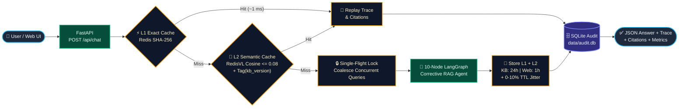
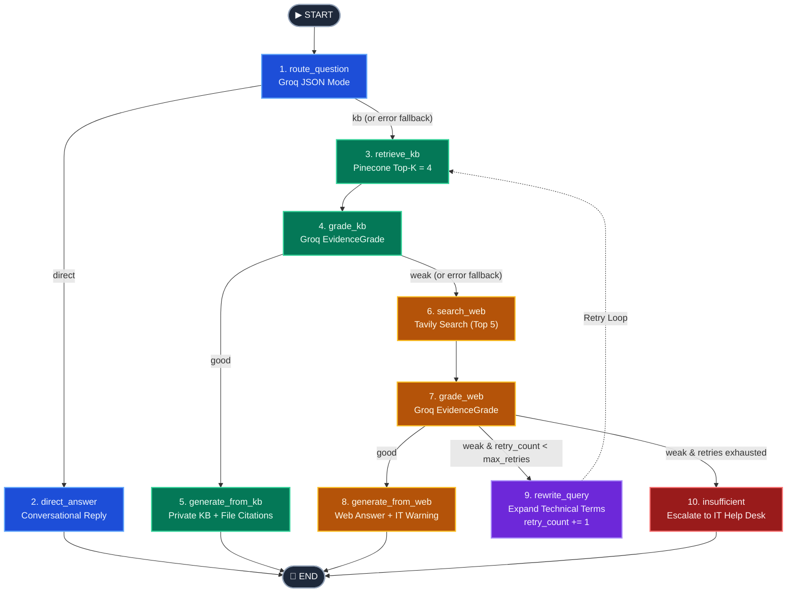

<div align="center">

# 🤖 Agentic RAG Copilot
### Enterprise IT Support Assistant powered by Corrective RAG & Two-Tier Semantic Caching

<p align="center">
  <strong>Self-correcting 10-node LangGraph orchestration</strong> •
  <strong>Sub-millisecond L1/L2 RedisVL caching</strong> •
  <strong>Live 3-panel observability UI</strong>
</p>

<p align="center">
  <a href="https://www.python.org/"></a>
  <a href="https://fastapi.tiangolo.com/"></a>
  <a href="https://langchain-ai.github.io/langgraph/"></a>
  <a href="https://groq.com/"></a>
  <a href="https://www.pinecone.io/"></a>
  <a href="https://redis.io/"></a>
  <a href="LICENSE"></a>
</p>

<p align="center">
  <a href="#-why-agentic-rag-copilot">Highlights</a> •
  <a href="#-architecture--agent-orchestration">Orchestration</a> •
  <a href="#-two-tier-semantic-cache">Semantic Cache</a> •
  <a href="#-quick-start">Quick Start</a> •
  <a href="#-api-reference">API</a> •
  <a href="#-observability-calibration--testing">Observability & Tests</a>
</p>

</div>

---

## ✨ Why Agentic RAG Copilot?

Standard RAG pipelines blindly stuff retrieved chunks into a prompt—even when the chunks are irrelevant or outdated. **Agentic RAG Copilot** replaces naive retrieval with a deterministic **Corrective RAG (CRAG)** state machine wrapped in a production-grade **two-tier semantic cache**:

| Pillar | What It Solves | How It's Built |
| :--- | :--- | :--- |
| 🧠 **Corrective Orchestration** | Stops hallucinations when private docs lack an answer | 10-node **LangGraph** workflow with Pydantic JSON routing, strict evidence grading, **Tavily** web fallback, and automatic query rewriting |
| ⚡ **Two-Tier Semantic Cache** | Cuts repeat LLM latency & token spend without stale answers | **L1** Redis SHA-256 exact match (~1 ms) + **L2** **RedisVL** cosine search (`<= 0.08`) with zero-flush versioning, single-flight coalescing, and a fail-open circuit breaker |
| 📚 **Idempotent KB Ingestion** | Prevents duplicate vectors & keeps cache synchronized | Admin-secured `.pdf`/`.docx`/`.md`/`.txt` pipeline with deterministic SHA-1 vector IDs and automatic `rag:kb_version` cache invalidation |
| 🔭 **Full-Stack Observability** | Eliminates "black-box AI" behavior in production | Live **3-panel Web UI** (workflow visualizer + trace replay), self-migrating **SQLite** audit log, and **Prometheus** `/metrics` instrumentation |

---

## 🖥️ Interactive 3-Panel Observability UI

The bundled web interface (`templates/index.html`, `static/js/app.js`, `static/css/styles.css`) turns every support query into an inspectable execution run:

```text
+-----------------------+----------------------------------------+-------------------------+
|   🔍 AGENT TRACES     |        💬 ENTERPRISE IT COPILOT        |  ⚙️ AGENT WORKFLOW      |
|-----------------------|----------------------------------------|-------------------------|
| [HIT] L2 Semantic     | User: How do I reset my VPN MFA?       |  [✓] 1. Cache Lookup    |
|  dist=0.041 | 12m ago |                                        |  [✓] 2. Intent Router   |
|  [R] Router -> KB     | Assistant:                             |  [✓] 3. Private KB      |
|  [R] KB -> 4 chunks   | Follow these steps from your internal  |  [✓] 4. Grade Evidence  |
|  [R] Grade -> GOOD    | IT handbook...                         |  [ ] 5. Web Fallback    |
|  [R] Answer -> KB     |                                        |  [ ] 6. Grade Web       |
|                       | Sources: [company_it_handbook.md]      |  [ ] 7. Query Rewrite   |
| Live Session Counters | Latency: 18 ms  |  Source: private_kb  |  [✓] 8. Final Answer    |
+-----------------------+----------------------------------------+-------------------------+
```

- **Dark & Light Themes** with persistent user preferences and Settings modal.
- **Live 8-Stage Workflow Visualizer** highlighting active/completed agent stages in real time.
- **Trace Replay on Cache Hits:** Replays the original agent execution steps alongside cache layer, cosine distance, and age.
- **External Safety Banners:** Automatically flags web-sourced answers with an IT validation disclaimer.
- **Two-Step Admin Upload Modal:** Verifies `X-Admin-Key` via `/api/admin/verify` before uploading and indexing documents.

---

## 🏗️ Architecture & Agent Orchestration

### 1. End-to-End Request Lifecycle

Every `/api/chat` call passes through the two-tier cache and single-flight coalescer before invoking the LangGraph agent, then persists telemetry to SQLite and Prometheus.



### 2. 10-Node LangGraph Corrective RAG Flow (`app/rag/workflow.py`)

Routing (`RouteDecision`) and grading (`EvidenceGrade`) enforce **Pydantic JSON-mode schemas** (`app/rag/state.py`) with Groq (`temperature=0`, `timeout=30s`, `max_retries=2`), eliminating brittle string parsing.



<details>
<summary><strong>📖 Click to expand Node-by-Node Execution & State Specification (10 Nodes + 11 State Fields)</strong></summary>

#### `AgentState` (`app/rag/state.py`)
Tracks 11 typed fields across the graph: `question`, `current_query`, `kb_docs`, `web_results`, `kb_grade`, `web_grade`, `answer`, `source_used`, `retry_count`, `trace`, and `citations`.

#### Node Reference (`app/rag/workflow.py`)

| # | Node | Role | Fail-Safe / Output |
| :-: | :--- | :--- | :--- |
| **1** | `route_question` | Classifies IT support questions (`kb`) vs. greetings/small talk (`direct`) using `RouteDecision`. | Falls back safely to `kb` on parse errors so real IT questions are never skipped. |
| **2** | `direct_answer` | Replies directly without touching Pinecone or Tavily. | Sets `source_used="direct"` (excluded from cache). |
| **3** | `retrieve_kb` | Queries Pinecone Serverless via `get_retriever()` using `current_query` (`TOP_K=4`). | Populates `kb_docs`. |
| **4** | `grade_kb` | Grades KB chunks via `EvidenceGrade` (`good` vs. `weak`). | Falls back safely to `weak` on errors to trigger web fallback. |
| **5** | `generate_from_kb` | Answers strictly from private KB chunks and attaches deduplicated filename citations (`type="private_kb"`). | Sets `source_used="private_kb"`. |
| **6** | `search_web` | Fallback query to `TavilySearch(max_results=5, include_answer=True)`. | Populates `web_results` and web `citations`; degrades cleanly on network/API issues. |
| **7** | `grade_web` | Grades Tavily evidence (`good` vs. `weak`). | Falls back safely to `weak` on errors. |
| **8** | `generate_from_web` | Answers strictly from web evidence and appends a mandatory disclaimer to validate with IT before modifying managed systems. | Sets `source_used="web_search"`. |
| **9** | `rewrite_query` | Reformulates the query with richer technical keywords, increments `retry_count`, and loops back to `retrieve_kb`. | Bounded by `MAX_RETRIES` (default `1`). |
| **10** | `insufficient` | Terminal safety fallback once retries are exhausted. | Sets `source_used="insufficient_evidence"` (excluded from cache) and directs user to the IT help desk. |

</details>

---

## ⚡ Two-Tier Semantic Cache (`app/services/semantic_cache.py`)

Engineered for real production traffic rather than a toy demo cache:

- **L1 Exact Match (`~1 ms`, zero embedding cost):** Normalizes queries (lowercase, collapsed whitespace, strips trailing `?!. `) and hashes via SHA-256 under `rag:exact:{version}:{hash}`.
- **L2 Semantic Match (RedisVL):** Wraps your local `BAAI/bge-small-en-v1.5` embedder in a `CustomTextVectorizer` over RedisVL's `rag_answer_cache` vector index, matching within cosine distance `<= 0.08` and scoped by RediSearch `Tag("kb_version")`.
- **Zero-Flush Versioned Invalidation:** Computes a composite version scope `{rag:kb_version}x{sha1(groq_model | embeddings_model | PROMPT_VERSION)[:6]}`. Ingesting a new document simply executes `INCR rag:kb_version`, instantly invalidating stale answers without ever calling `FLUSHALL` (which would drop the RediSearch index).
- **Selective TTLs & Stampede Jitter:**
  - `private_kb` answers -> **24 hours** (`86400s`) + `0–10%` random jitter (`random.uniform(1.0, 1.1)`).
  - `web_search` answers -> **1 hour** (`3600s`) + `0–10%` random jitter.
  - `direct` & `insufficient_evidence` -> **Never cached**.
- **Single-Flight Request Coalescing:** Per-question locks (`_inflight` guarded by `_inflight_guard`) guarantee identical concurrent questions execute the LangGraph workflow only once; waiting threads pick up the fresh L1 entry and record a `coalesced` hit.
- **Fail-Open Circuit Breaker:** Tight `0.25s` Redis timeouts ensure cache stalls never block chat. Any Redis error trips a 30-second circuit breaker (`CACHE_BREAKER_SECONDS=30`) and fails open directly to the LangGraph agent.

> [!IMPORTANT]
> **Never run `FLUSHALL` on Redis.** Flushing deletes the RediSearch vector index used by RedisVL. Always invalidate cached entries safely by incrementing the version counter:
> ```bash
> docker compose exec redis redis-cli INCR rag:kb_version
> ```

---

## 📥 Vector Store & Document Ingestion

| Component | Details |
| :--- | :--- |
| **Local Embeddings** | `BAAI/bge-small-en-v1.5` (384 dimensions) via `HuggingFaceEmbeddings` — zero embedding API cost |
| **Dimension Safety** | `ensure_index()` validates index dimensions against `EMBEDDING_DIMENSIONS` (`384`, `1536`, `3072`) and auto-provisions an AWS `us-east-1` Pinecone Serverless cosine index if missing |
| **Idempotent Upserts** | `add_documents()` hashes `source\|start_index\|page_content` with SHA-1 so re-ingesting unchanged files overwrites instead of duplicating vectors |
| **Supported Formats** | `.pdf` (`PyPDFLoader`), `.docx` (`python-docx`), `.md` / `.txt` (`utf-8-sig` with `latin-1` fallback) |
| **Chunking Strategy** | `RecursiveCharacterTextSplitter(chunk_size=900, chunk_overlap=120, add_start_index=True)` |
| **Upload Hardening** | Constant-time `X-Admin-Key` check (`secrets.compare_digest`), rejects unset/`"change-me"` server keys (`503`), enforces `10 MB` cap (`413`), executes indexing off the event loop via `run_in_threadpool`, and calls `bump_kb_version()` |

---

## 🧰 Tech Stack

| Layer | Technologies |
| :--- | :--- |
| **Orchestration** | LangGraph (`StateGraph`), LangChain Core, Pydantic v2 |
| **LLM & Search** | Groq (`openai/gpt-oss-20b`), Tavily Search (`langchain-tavily`) |
| **Embeddings & Vector DB** | HuggingFace `BAAI/bge-small-en-v1.5` (`sentence-transformers`), Pinecone Serverless |
| **Semantic Cache** | Redis Stack (`redis/redis-stack-server`), `redis`, `redisvl` |
| **Backend & UI** | FastAPI, Uvicorn, Jinja2, Vanilla JavaScript & CSS |
| **Observability & QA** | SQLite (`data/audit.db`), `prometheus-client`, `pytest`, `fakeredis` |

---

## 📂 Project Structure

```text
Agentic-RAG-Copilot/
├── app/
│   ├── main.py                     # FastAPI app, /metrics mount, static/templates, /health
│   ├── api/
│   │   └── routes.py               # /api/chat, /api/ingest (admin), /api/admin/verify, /api/health
│   ├── core/
│   │   ├── config.py               # Pydantic BaseSettings (.env config & defaults)
│   │   └── logging.py              # Application logger setup
│   ├── rag/
│   │   ├── state.py                # AgentState TypedDict, RouteDecision, EvidenceGrade
│   │   ├── vectorstore.py          # Local BGE embeddings, Pinecone auto-init, SHA-1 upserts
│   │   └── workflow.py             # 10-node LangGraph CRAG graph & ask() entrypoint
│   └── services/
│       ├── semantic_cache.py       # L1/L2 RedisVL cache, single-flight, breaker, Prometheus
│       ├── ingestion.py            # PDF/DOCX/MD/TXT loader & chunker (900 / 120 overlap)
│       └── audit.py                # Self-migrating SQLite query_audit logger
├── data/
│   ├── sample_kb/                  # Bundled IT Handbook & Service Desk Runbook (.md)
│   ├── cache_pairs.json            # 12 positive paraphrases + 12 near-miss negatives
│   └── audit.db                    # Auto-initialized SQLite audit trail
├── scripts/
│   ├── calibrate_cache.py          # Cosine threshold precision/recall calibrator
│   └── benchmark_cache.py          # Cold vs. L1 vs. L2 p50/p95 latency benchmark
├── static/
│   ├── css/styles.css              # Dark/light responsive styling
│   └── js/app.js                   # Live workflow visualizer, trace replay, safe markdown, admin UI
├── templates/
│   └── index.html                  # 3-panel Copilot interface
├── tests/
│   └── test_semantic_cache.py      # 8 Redis-free unit tests (fakeredis + FakeSemantic)
├── docker-compose.yml              # Redis Stack (256MB maxmemory, allkeys-lru)
├── ingest_sample_kb.py             # CLI seeder for data/sample_kb/
├── requirements.txt                # Python dependencies
├── run.py                          # Local Uvicorn entrypoint (127.0.0.1:8000)
└── LICENSE                         # Apache License 2.0
```

---

## 🚀 Quick Start

### Prerequisites
- **Python 3.11+**
- **Docker & Docker Compose** *(for Redis Stack semantic cache; optional—app fails open if Redis is offline)*
- API keys for **[Groq](https://console.groq.com/)**, **[Pinecone](https://www.pinecone.io/)**, and **[Tavily](https://tavily.com/)**

### 1. Clone & Set Up Environment

```bash
git clone https://github.com/RohanPatil1818/Agentic-RAG-Copilot.git
cd Agentic-RAG-Copilot

python -m venv .venv
# Windows
.venv\Scripts\activate
# macOS / Linux
source .venv/bin/activate

pip install -r requirements.txt
```

### 2. Configure `.env`

Create a `.env` file in the project root (never commit `.env` to Git):

```env
# --- Required API Keys ---
GROQ_API_KEY=your_groq_api_key
TAVILY_API_KEY=your_tavily_api_key
PINECONE_API_KEY=your_pinecone_api_key
ADMIN_API_KEY=choose-a-strong-admin-secret
```

<details>
<summary><strong>⚙️ Optional Configuration Overrides (Defaults Shown)</strong></summary>

```env
# --- Pinecone & RAG Settings ---
PINECONE_INDEX_NAME=fde-it-support-rag
PINECONE_NAMESPACE=company-it-kb
EMBEDDINGS_MODEL=BAAI/bge-small-en-v1.5
GROQ_MODEL=openai/gpt-oss-20b
TOP_K=4
MAX_RETRIES=1

# --- Semantic Cache Settings ---
REDIS_URL=redis://localhost:6379
CACHE_ENABLED=true
CACHE_DISTANCE_THRESHOLD=0.08
CACHE_TTL_KB_SECONDS=86400
CACHE_TTL_WEB_SECONDS=3600
CACHE_BREAKER_SECONDS=30
```

</details>

### 3. Start Redis Stack (Semantic Cache)

```bash
docker compose up -d
```

> [!TIP]
> `docker-compose.yml` runs `redis/redis-stack-server:latest` on port `6379` with a `256mb` memory cap and `allkeys-lru` eviction. If you skip this step, the circuit breaker automatically fails open and serves requests directly via LangGraph.

### 4. Seed the Sample IT Knowledge Base

Indexes `company_it_handbook.md` and `service_desk_runbook.md` into Pinecone (auto-creating the 384-dim Serverless index on first run) and bumps `rag:kb_version`:

```bash
python ingest_sample_kb.py
```

### 5. Launch the Copilot

```bash
python run.py
```

| Service | Local URL |
| :--- | :--- |
| **3-Panel Copilot UI** | `http://127.0.0.1:8000` |
| **Swagger / OpenAPI Docs** | `http://127.0.0.1:8000/docs` |
| **Prometheus Metrics** | `http://127.0.0.1:8000/metrics` |
| **Health Check** | `http://127.0.0.1:8000/api/health` |

---

## 🔌 API Reference

| Method | Endpoint | Auth | Description |
| :--- | :--- | :--- | :--- |
| `GET` | `/` | Public | Renders the 3-panel Copilot web interface. |
| `GET` | `/api/health` (`/health`) | Public | Returns service liveness status. |
| `GET` | `/metrics` | Public | Exposes Prometheus counters and latency histograms. |
| `POST` | `/api/chat` | Public | Executes L1/L2 cache lookup -> LangGraph CRAG agent -> SQLite audit log. |
| `POST` | `/api/admin/verify` | `X-Admin-Key` | Constant-time validation of the admin key for the UI upload flow. |
| `POST` | `/api/ingest` | `X-Admin-Key` | Uploads & indexes `.pdf`/`.docx`/`.md`/`.txt` (max 10 MB) and bumps cache version. |

<details>
<summary><strong>🧪 Click to view cURL Examples & Sample JSON Response</strong></summary>

#### Query the Copilot
```bash
curl -X POST http://127.0.0.1:8000/api/chat \
  -H "Content-Type: application/json" \
  -d '{"question": "How do I reset my VPN password?"}'
```

#### Sample Response
```json
{
  "answer": "Based on the company IT handbook, you can reset your VPN password via the self-service portal...",
  "source_used": "private_kb",
  "trace": [
    "Cache lookup -> no match, running full agent",
    "Router -> KB",
    "Private KB retrieval -> 4 chunks",
    "KB evidence grade -> GOOD",
    "Answer generation -> PRIVATE KB"
  ],
  "citations": [
    {
      "title": "company_it_handbook.md",
      "url": "",
      "type": "private_kb"
    }
  ],
  "rewritten_query": "How do I reset my VPN password?",
  "cache": {
    "status": "miss"
  },
  "latency_ms": 1420
}
```

#### Upload & Index a Document (Admin)
```bash
curl -X POST http://127.0.0.1:8000/api/ingest \
  -H "X-Admin-Key: your-admin-secret" \
  -F "file=@/path/to/it_policy.pdf"
```

</details>

---

## 📊 Observability, Calibration & Testing

### 1. Run Unit Tests (Zero External Dependencies)
Executes all 8 `pytest` unit tests in `tests/test_semantic_cache.py` using `fakeredis` and a `FakeSemantic` test double—validating L1/L2 hits, trace replay, KB version invalidation, non-cacheable sources, fail-open circuit breaker behavior, and TTL jitter:

```bash
pytest -v
```

### 2. Calibrate the Semantic Distance Threshold
Evaluates 12 positive paraphrase pairs and 12 near-miss negative pairs (`data/cache_pairs.json`) across cosine thresholds `0.02–0.24` to recommend the highest threshold maintaining at least 98% precision:

```bash
python scripts/calibrate_cache.py data/cache_pairs.json
```

### 3. Benchmark Cold vs. L1 vs. L2 Latency
Measures p50/p95 latencies across cold cache misses, warm L1 exact hits, and reworded L2 semantic hits:

```bash
docker compose exec redis redis-cli INCR rag:kb_version
python scripts/benchmark_cache.py http://localhost:8000
```

<details>
<summary><strong>📈 Prometheus Metrics & SQLite Audit Schema</strong></summary>

#### Prometheus Metrics (`/metrics`)
| Metric | Type | Labels | Purpose |
| :--- | :--- | :--- | :--- |
| `rag_cache_requests_total` | Counter | `outcome`, `layer` | Tracks `hit`, `miss`, `coalesced`, and `error` across `exact`, `semantic`, and `none`. |
| `rag_cache_errors_total` | Counter | `op` | Counts fail-open Redis errors (`lookup`, `store`, `bump_version`). |
| `rag_cache_stores_total` | Counter | `source` | Counts cached entries by origin (`private_kb`, `web_search`). |
| `rag_cache_lookup_seconds` | Histogram | `layer` | Lookup latency distribution (`exact` vs. `semantic`). |
| `rag_cache_hit_distance` | Histogram | — | Cosine distance distribution for L2 semantic hits. |
| `rag_request_seconds` | Histogram | `cache` | End-to-end `/api/chat` latency (`hit` vs. `miss`). |

#### SQLite Audit Log (`data/audit.db`)
Automatically initializes the `query_audit` table and self-migrates columns (`cache_status`, `cache_layer`, `latency_ms`) via `ALTER TABLE` on startup. Audit write errors are logged without failing user responses.

</details>

---

## 📄 License

Distributed under the **Apache License 2.0**. See [`LICENSE`](LICENSE) for more information.

---

<div align="center">
  Built by <a href="https://github.com/RohanPatil1818"><strong>Rohan Patil</strong></a> •
  If you find this architecture useful, consider giving the repo a ⭐!
</div>